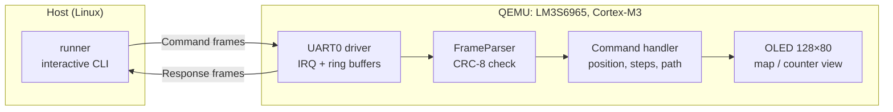

# GPS Step Counter: bare-metal Rust on a Cortex-M3

`no_std` Rust firmware for the TI Stellaris LM3S6965 (ARM Cortex-M3), running in QEMU. A host program, the runner, sends steps over a simulated UART. The board tracks position and step count and draws either the walked path or the step counter on its 128×80 OLED screen.

The focus is a sound, interrupt-driven UART driver and a checksummed message protocol that recovers from corrupted or dropped bytes.

Built for the TU Delft MSc course *Software Systems* (CESE4015), embedded systems assignment, together with Alberto Levorato.

## Highlights

- **Interrupt-driven UART driver** for UART0 (115200 baud, 8N1, hardware FIFOs) with fixed-size 256-byte RX and TX ring buffers and no heap allocation. A full buffer never crashes the program or overwrites queued bytes: an outgoing message that doesn't fit is dropped whole, and incoming bytes are dropped until there is room.
- **Own `Mutex<T>`** built on critical sections, used for the buffers shared between the main loop and the UART interrupt handler.
- **Framed protocol** in a shared `no_std` crate used by both the firmware and the runner: start byte, length, [postcard](https://crates.io/crates/postcard) payload, CRC-8.
- **Fault tolerant.** The CRC rejects damaged frames, and the parser resynchronises on noise, repeated start bytes and dropped bytes. An exhaustive fault-injection test corrupts or drops every byte of every command's frame and checks that nothing wrong is decoded and the following frames still arrive.
- **Documented `unsafe`.** Each `unsafe` block has a `SAFETY:` comment that says why it is sound.

## How it works



### Frame format

| Field    | Size     | Content                                         |
|----------|----------|-------------------------------------------------|
| Start    | 1 byte   | `0xAA`                                          |
| Length   | 1 byte   | payload length, 1–64                            |
| Payload  | 1–64     | postcard-serialised `Command` or `Response`     |
| Checksum | 1 byte   | CRC-8 (polynomial `0x07`) over the payload      |

### Messages

| Runner input                  | Command sent                    | Board reply           |
|-------------------------------|---------------------------------|-----------------------|
| `step <dx> <dy>`              | `Step { dx, dy }` (metres)      | `Ack`                 |
| `view map` / `view counter`   | `SwitchView { page }`           | `Ack`                 |
| `steps`                       | `GetSteps`                      | `StepCount { count }` |
| `reset`                       | `Reset`                         | `Ack`                 |
| *(valid CRC, unknown payload)* |                                | `Error { code: 1 }`   |

On the map, 1 pixel is 1 metre. The walk starts in the centre of the screen.

## Getting started

Requirements: Linux, Rust via [rustup](https://rustup.rs), and QEMU for ARM.

```bash
rustup target add thumbv7m-none-eabi
sudo apt install qemu-system-arm   # Debian/Ubuntu
cargo run                          # builds the firmware and starts it in QEMU through the runner
```

Type `help` in the runner to see the commands.

### Tests

The workspace builds for `thumbv7m-none-eabi` by default, so the protocol tests need the host target:

```bash
cargo test -p comm_protocol --target x86_64-unknown-linux-gnu
```

## Project layout

```text
embedded-code/            firmware (no_std, no_main)
  src/main.rs             main loop: UART bytes -> frame parser -> command handler -> screen
  src/uart.rs             interrupt-driven UART0 driver with ring buffers
  src/mutex.rs            critical-section Mutex<T>
  src/status.rs           position, step count and path history
  src/drawing/            OLED driver over SSI and an 8x16 digit font
comm_protocol/            shared no_std crate: messages, CRC-8, frame encoder and parser
  tests/protocol.rs       protocol and fault-injection tests
runner/                   host CLI: starts QEMU, sends commands, prints replies
```

## Known limitations

- If the length byte itself is damaged into a larger valid length, the parser swallows the frame that follows before it is back in sync. COBS framing, which postcard supports, would avoid this.
- The map stores the first 512 positions, and positions are clamped to the screen edges.
- The firmware has only been run in QEMU. It doesn't set up the PLL, peripheral clocks or pin functions that a real LM3S6965 needs, and the baud rate divisors assume a 50 MHz clock.

## Acknowledgements

The course template, the QEMU runner library ([`tudelft-arm-qemu-runner`](https://crates.io/crates/tudelft-arm-qemu-runner)) and the LM3S6965 peripheral access crate ([`tudelft-lm3s6965-pac`](https://crates.io/crates/tudelft-lm3s6965-pac)) were provided by the TU Delft Software Systems course staff.
